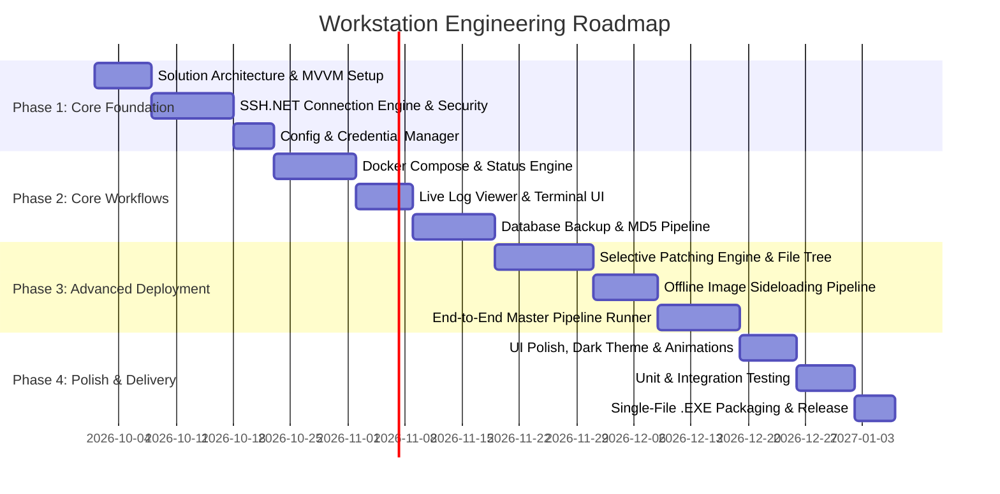

# Product Requirement Document (PRD) & Engineering Roadmap
## Project: Agentless Desktop VPS Management & Deployment Workstation

---

## 1. Executive Summary

### 1.1 Product Vision
To build a lightweight, high-performance, agentless desktop application in C# and Avalonia UI that empowers developers and DevOps engineers to manage, deploy, patch, and monitor VPS infrastructure and Docker Compose stacks directly from their local workstation over encrypted SSH pipelines—with zero remote server overhead and full support for air-gapped or network-restricted environments.

### 1.2 Core Value Proposition & Differentiators
* **Zero VPS Footprint (Agentless)**: Unlike 1Panel, Coolify, or Portainer, this workstation installs no daemons or web servers on the remote host, consuming 0 MB of RAM/CPU on the VPS.
* **Air-Gapped / Restricted Network Support**: Native support for selective file hot-swapping and offline Docker image sideloading (`docker save` $\rightarrow$ SCP $\rightarrow$ `docker load`) when public registries or CI/CD pipelines are unreachable.
* **Local Security Model**: No public web dashboards exposed to the internet; all actions are governed locally over SSH.
* **Cross-Platform C# Desktop**: Built with C# .NET 8 and Avalonia UI for native Windows performance with cross-platform (macOS/Linux) expansion capability.

---

## 2. Product Architectural & Quality Goals

| Pillar | Architectural Requirement | Target Metric / Implementation |
| :--- | :--- | :--- |
| **Speed** | Instant startup, async execution, parallel transfer stream | $< 1.5\text{s}$ app cold start, non-blocking UI during transfers. |
| **Reliability** | Atomic operations, pre-flight safety gates, automatic rollback | Mandatory pre-deploy DB dumps, MD5 checksum validation post-transfer. |
| **Security** | Secure credential management, no server daemon, key-based auth | Local OS Credential Store (Windows Credential Manager / DPAPI), zero unencrypted storage. |
| **Best Practices** | Clean Code, MVVM Architecture, SOLID principles | `CommunityToolkit.Mvvm`, `SSH.NET`, asynchronous `async/await` tasks throughout. |

### 2.1 Professional Project Directory Structure (C# / Avalonia .NET 8)

```text
VpsManager.sln                       # Central .NET Solution File
├── src/
│   ├── VpsManager.Client/           # UI Layer (Avalonia Application)
│   │   ├── App.axaml                # App resources, styling, & themes
│   │   ├── App.axaml.cs             # Application initialization & DI setup
│   │   ├── Program.cs               # Avalonia entry point & platform builder
│   │   ├── Assets/                  # Icons, fonts, and branding graphics
│   │   ├── ViewModels/              # MVVM ViewModels (State & UI Logic)
│   │   │   ├── ViewModelBase.cs
│   │   │   ├── MainViewModel.cs
│   │   │   ├── DeployViewModel.cs
│   │   │   ├── PatchViewModel.cs
│   │   │   ├── DatabaseViewModel.cs
│   │   │   ├── DockerViewModel.cs
│   │   │   └── TerminalViewModel.cs
│   │   ├── Views/                   # Avalonia XAML Views
│   │   │   ├── MainWindow.axaml
│   │   │   ├── DeployView.axaml
│   │   │   ├── PatchView.axaml
│   │   │   ├── DatabaseView.axaml
│   │   │   ├── DockerView.axaml
│   │   │   └── Controls/            # Reusable UI Controls (Terminal Log Viewer, Stepper)
│   │   ├── Styles/                  # Custom XAML styles & dark theme definitions
│   │   └── Converters/              # ValueConverters (Status to Color, Bytes to Human readable)
│   │
│   ├── VpsManager.Core/             # Business Logic & Infrastructure Layer
│   │   ├── Services/                # Core Application Services
│   │   │   ├── ISshService.cs       # SSH connection interface
│   │   │   ├── SshService.cs        # Renci.SshNet wrapper implementation
│   │   │   ├── IPatchService.cs     # Selective file hot-swap engine
│   │   │   ├── PatchService.cs
│   │   │   ├── IDatabaseService.cs  # Dump, MD5 check & migration engine
│   │   │   ├── DatabaseService.cs
│   │   │   ├── IDockerService.cs    # Docker Compose remote controller
│   │   │   ├── DockerService.cs
│   │   │   ├── ISideloadService.cs  # Offline image tar transfer engine
│   │   │   └── SideloadService.cs
│   │   ├── Security/                # Credential Management
│   │   │   ├── ICredentialStore.cs
│   │   │   └── WindowsCredentialStore.cs # DPAPI / Windows Credential Manager
│   │   ├── Models/                  # Data Transfer Objects & Domain Models
│   │   │   ├── ConnectionProfile.cs
│   │   │   ├── ContainerStatus.cs
│   │   │   ├── FilePatchNode.cs
│   │   │   ├── DatabaseBackup.cs
│   │   │   └── SystemConfig.cs
│   │   └── Helpers/                 # Utility classes (MD5 Streams, File Compressors)
│   │       ├── HashHelper.cs
│   │       ├── CompressionHelper.cs
│   │       └── AnsiColorParser.cs   # Formats SSH log colors for AvaloniaEdit
│   │
│   └── VpsManager.Desktop/          # Single-File Executable Packaging Project
│       └── VpsManager.Desktop.csproj
│
└── tests/
    ├── VpsManager.Core.Tests/       # Unit tests for Services & Hash Integrity
    └── VpsManager.Client.Tests/     # ViewModels unit tests
```


---

## 3. Detailed Technical Requirements & Features

### Module A: SSH & Connection Engine (`SshService.cs`)
* **Key-Based & Password Auth**: Support standard SSH password authentication as well as encrypted Private Keys (`OpenSSH`, `.pem`, `.ppk`).
* **Connection Pooling & Keep-Alive**: Maintain persistent, auto-reconnecting SSH channels with active heartbeat pings to avoid timeouts during long deployments.
* **Streaming Output Handling**: Real-time stdout/stderr output piping for long-running scripts via events/observables.

### Module B: Selective Patching Engine (`SelectivePatchService.cs`)
* **Local File Change Indexer**: Scan local directory trees against customizable ignore filters (`.git`, `node_modules`, `*.env`).
* **Interactive Patch Selector UI**: TreeView/DataGrid with checkable nodes for developers to pick target files.
* **Atomic Hot-Swap Transfer**:
  1. Package selected files into an in-memory ZIP buffer.
  2. Upload ZIP via SCP to target staging directory on VPS.
  3. Extract remote ZIP and swap target files atomically.
  4. Trigger target container reload/rebuild (`docker compose restart <service>`).

### Module C: Infrastructure Sideloading Engine (`SideloadService.cs`)
* **Local Image Exporter**: Run local `docker save` command or export local tarballs.
* **Streaming Transfer with Progress Bar**: Stream large tar archives via SCP to VPS with exact byte-progress reporting.
* **Remote Ingestion**: Trigger remote `docker load -i <image.tar>` and clean up temporary remote tar archives automatically.

### Module D: Database Lifecycle & Safety Engine (`DatabaseService.cs`)
* **Pre-Deploy Safety Dump**: Automated trigger of `pg_dump` or `mysqldump` inside target DB containers prior to any code or schema update.
* **MD5 Verification Pipeline**: Compute MD5 hash of DB dump on remote host $\rightarrow$ Transfer dump via SCP $\rightarrow$ Compute MD5 locally $\rightarrow$ Compare & confirm data integrity.
* **One-Click Restore & Migration**: UI interface to execute schema migrations or roll back to historical remote/local database dumps safely.

### Module E: Docker Compose & VPS Control Center (`DockerService.cs`)
* **Visual Compose Manager**: GUI representation of services defined in `docker-compose.yml` (`Up`, `Down`, `Build`, `Restart`, `Logs`).
* **Live Log Streamer**: Integrated terminal viewer (`AvaloniaEdit`) supporting colorized log output (ANSI color code parser) and autoscroll control.
* **Quick Health Status**: Container CPU, memory, uptime, and exit-code reporting.

---

## 4. Non-Functional Requirements (NFRs)

1. **Security**:
   * Passwords and SSH private key passphrases must never be stored in plain-text JSON. Use `ProtectedData` (DPAPI on Windows) or Windows Credential Manager.
   * Host key verification must be enforced to prevent Man-in-the-Middle (MitM) attacks.
2. **Performance**:
   * UI frame rate must stay smooth ($60\text{ fps}$) while streaming continuous SSH logs or running heavy file indexing.
   * File hashing (MD5) must utilize chunked stream processing (`cryptoStream`) to avoid high memory spikes on large DB dumps ($> 5\text{GB}$).
3. **Error Handling & Resilience**:
   * Failure of a remote command during pipeline execution must abort subsequent steps and prompt the user for an automatic rollback.
   * All network operations must implement explicit timeouts ($30\text{s}$ for SSH handshake, configurable for long SCP operations).

---

## 5. Engineering Roadmap & Phase Breakdown



### Phase 1: Architecture Foundation & Core SSH Engine
* **Goal**: Establish C# Avalonia project, MVVM structure, and resilient SSH/SCP communication layer.
* **Deliverables**:
  * Avalonia UI desktop scaffold with Fluent Dark theme navigation sidebar.
  * `SshService` wrapping `Renci.SshNet` with async command execution and auto-reconnect.
  * Windows Credential Manager integration for safe password/key storage.

### Phase 2: Docker Orchestration & Database Safety
* **Goal**: Implement remote container control, log streaming, and database backup verification.
* **Deliverables**:
  * Docker Compose dashboard (`Up`, `Down`, `Build`, Status grid).
  * `AvaloniaEdit` terminal view with ANSI color code rendering for live log streaming.
  * Database dump manager with automated remote/local MD5 checksum verification.

### Phase 3: Selective Patching & Sideloading
* **Goal**: Implement the key features for restricted network deployments.
* **Deliverables**:
  * Fast local directory diffing engine with ignore pattern filters.
  * Interactive UI TreeView for picking specific files to hot-swap.
  * Atomic ZIP transfer & extraction engine over SCP.
  * `docker save` $\rightarrow$ SCP $\rightarrow$ `docker load` sideloading pipeline with UI progress bar.

### Phase 4: Master Pipeline, UX Polish & Release
* **Goal**: End-to-end automated deployment pipeline, error recovery, and release packaging.
* **Deliverables**:
  * Master 1-Click Production Deployment Pipeline with step-by-step progress stepper UI.
  * Automatic pre-deploy safety gates (DB backup + health check before migration).
  * Self-contained single-file `.exe` build for zero-dependency distribution.

---

## 6. Technology Stack Summary

* **Language**: C# 12 (.NET 8 SDK)
* **UI Framework**: Avalonia UI 11 (`Avalonia.Themes.Fluent`)
* **Architecture Pattern**: MVVM using `CommunityToolkit.Mvvm`
* **SSH / SCP Library**: `SSH.NET` (`Renci.SshNet`)
* **Terminal Control**: `AvaloniaEdit`
* **Secure Storage**: `AdysTech.CredentialManager` / `System.Security.Cryptography`
* **Serialization**: `System.Text.Json`
