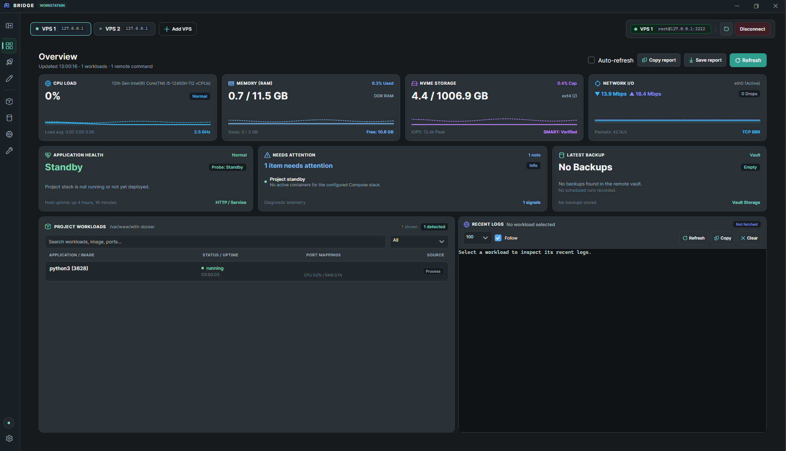
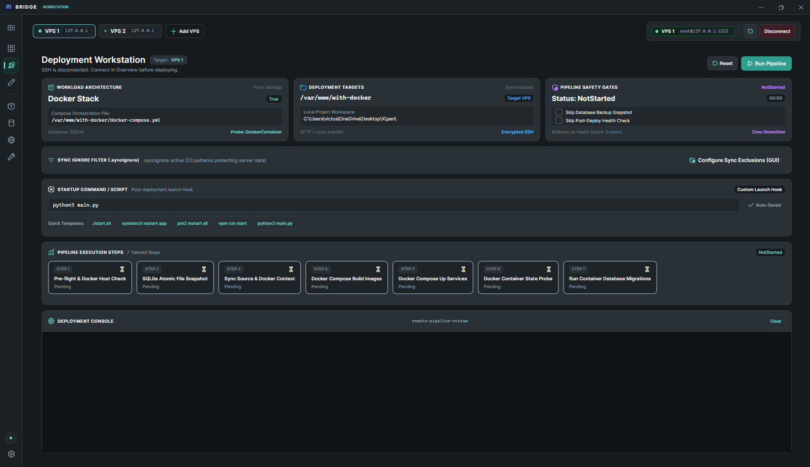

# Bridge Workstation

### The Agentless Control Plane for Bare-Metal and Cloud VPS

Turn any standard Linux or Windows VPS into a self-hosted cloud platform directly from your desktop. Zero server-side daemons. Zero external pipeline queues. Pure SSH speed.

---





---

## The Pitch

Most deployment tools force you into an unpalatable compromise:

1. **Pay the Cloud Tax**: Rely on cloud-hosted CI/CD pipelines that queue behind rate limits, demand public repository access, cost money for runner minutes, and take five minutes to build an image for a one-line typo fix.
2. **Pay the RAM Tax**: Install web-based PaaS managers like Coolify, Portainer, or CapRover that run heavy background daemons, eating up 500 MB to 1.5 GB of RAM before your application even boots—crippling affordable $4 to $6/month VPS servers.
3. **Walk the Tightrope**: Slog through raw SSH terminals and WinSCP windows, where one mistyped `rm` or botched `docker compose down` destroys production databases without a safety net.

**Bridge eliminates the compromise.**

It runs 100% locally on your workstation as a high-performance desktop application, communicating directly with your remote servers over encrypted SSH and SFTP. It leaves **zero agent footprint** on your server, bypasses cloud network restrictions entirely, and gives you visual superpowers: live telemetry, automated pre-deploy database dumps, sub-second surgical hot-patching, and bare-metal server hardening.

---

## What Makes Bridge Different

### Comparative Overview

| Operational Vector | Bridge Workstation | Cloud PaaS (Coolify / Dokku) | Cloud CI/CD (GitHub / GitLab) | Raw SSH (PuTTY / Termius) |
| :--- | :--- | :--- | :--- | :--- |
| **Server Footprint** | 0 MB (Purely agentless, runs on desktop) | 500 MB to 1.5 GB background RAM tax | 0 MB (Ephemeral SSH triggers) | 0 MB |
| **Network Independence** | Fully autonomous (Air-gapped and private nets) | Requires outbound internet connectivity | Requires public webhooks and cloud access | Direct connection |
| **Hot-Fix Turnaround** | 2 to 5 seconds via surgical SFTP diffs | 2 to 5 minutes (Full container rebuilds) | 3 to 10 minutes (Queue runner, push, pull) | Manual copy, zero rollback |
| **Pre-Flight Safety Net** | Automatic DB dump and rollback snapshot | Manual configuration | Manual YAML scripting | None (High human error risk) |
| **State Mutation Lockout** | Hardware-grade mutual exclusion locks | Web UI queues | Cloud runner concurrency limits | None |
| **Host Hardening Engine** | 1-Sweep modular bare-metal provisioner | Bootstrap shell script | Requires separate Ansible/Terraform | Manual terminal commands |
| **Credential Storage** | Windows DPAPI hardware-backed encryption | Server-side database or env variables | Third-party cloud secret vaults | Plaintext config files |

### The Core Differentiators

- **The Zero-RAM Advantage**: Your VPS was purchased to run your products, not to host your deployment tool. By keeping the execution engine on your local desktop, Bridge leaves 100% of your remote CPU, memory, and NVMe bandwidth dedicated to serving production traffic.
- **Surgical Hot-Patching in Seconds**: Stop rebuilding entire Docker images and container layers just to update a Python controller, tweak an Nginx configuration, or fix a frontend template. Bridge identifies modified files, uploads only the diffs, and triggers an atomic service reload in under five seconds.
- **Built for Network Sovereignty**: Built specifically for engineers operating behind firewalls, strict network policies, or regional sanctions where GitHub Actions, container registries, or third-party webhooks fail or crawl. Bridge talks straight to your VPS IP over port 22.
- **Fail-Safe Release Guardrails**: Every deployment can automatically trigger a verified database snapshot, run pre-flight SSH connectivity tests, and verify service readiness through an automated polling retry loop. If health checks fail, Bridge rolls back state automatically.

---

## Workstation Tour: The Feature Playbook

Bridge organizes your operational workflow into eight dedicated control surfaces.

---

### 1. Overview: Live Vital Signs Without Agent Overhead

The Overview tab is your real-time server command bridge. Instead of running heavy monitoring daemons that eat up server memory, Bridge polls your VPS metrics over lightweight SSH commands and visualizes them on your desktop screen with near-zero overhead.

- **Instant Hardware Gauges**: Live CPU load percentage, RAM usage metrics, and NVMe disk partition saturation indicators with visual sparklines.
- **Automated Runtime Audit**: Instant inventory detection reporting exact installed versions of Docker, Node.js, Python, Git, Nginx, PostgreSQL, and PM2.
- **Latency and Link Health**: Real-time round-trip latency indicators and persistent one-click connection management with host key verification.
- **Workload Inspector**: Live process and container tracking showing status, uptime, and port mappings.
- **Integrated Recent Logs**: Stream the tail output of your primary service directly on the dashboard without opening a separate shell.

---

### 2. Deploy: From Local Working Tree to Live Production in One Motion

The Deploy tab turns complex deployment sequences into an automated, multi-stage release engine. It handles five project architectures: Docker Compose stacks, single Dockerfile containers, native systemd or PM2 Linux services, Telegram bots, and static web apps.

- **Automated Pre-Flight Sanity Checks**: Validates target remote directory accessibility, verifies disk headroom, and tests SSH latency before altering remote files.
- **Local Pre-Compilation Hook**: Optionally executes local compilation (such as `npm run build`, `dotnet publish`, or `cargo build`) before transmission.
- **Automated Pre-Deploy Database Shield**: Takes a timestamped, verified database dump before syncing source code.
- **Intelligent Selective Sync**: Syncs files over SFTP while strictly respecting rules in `.gitignore` and `.syncignore`, preventing node_modules, build caches, and local secrets from crossing the wire.
- **Resilient Health Probing with Retry Loops**: Verifies service survival via HTTP response code probes, TCP port binding tests, Docker container health status, or custom shell checks. Features automated 5-attempt polling retries to accommodate slow container initialization.
- **Automatic Failure Rollbacks**: If your new build fails its health check, Bridge automatically triggers a rollback to keep your production site online.

---

### 3. Patch: Kill the Rebuild Cycle with Sub-Second Hot-Swaps

Stop waiting five minutes for `docker build` when fixing a minor defect. The Patch tab is a surgical synchronization engine that delivers code modifications to remote containers in seconds.

- **Dual-Engine Scanning**:
  - **Git Diff Engine**: Scans your local Git repository against the working index or remote tracking branch to find modified, newly created, and deleted files.
  - **Filesystem Scanner**: Scans modification timestamps across your project tree for non-Git projects.
- **Searchable Visual File Tree**: Browse your changes in an interactive directory tree with file size metrics and granular selection checkboxes.
- **Automatic Pre-Patch Snapshots**: Archives target remote files into a compressed snapshot on the server before anything is overwritten.
- **Instant One-Click Reversion**: If your hot-patch introduces an unexpected runtime error, click Rollback Last Patch to restore the remote directory to its exact prior state.
- **Post-Patch Atomic Reload**: Automatically signals the remote container or daemon to reload without restarting the host.

---

### 4. Database: The Self-Defending Database Vault

The Database tab puts an end to writing manual `pg_dump` and `mysqldump` commands in raw SSH terminals. It manages database backups, integrity verification, and scheduled automation across PostgreSQL, MySQL, MariaDB, MongoDB, and SQLite.

- **Container and Host Agnostic**: Connects seamlessly to databases running inside Docker containers or installed bare-metal on the host OS.
- **One-Click Manual Snapshots**: Create on-demand database dumps before critical operations with customizable naming.
- **MD5 Checksum Verification**: Every backup archive in the remote vault is cataloged with file size, creation timestamp, and a calculated MD5 integrity badge.
- **Locked One-Click Restores**: Restores database archives directly into your database container, protected by mutual-exclusion safety locks to prevent concurrent mutations.
- **Autonomous Cron Scheduler**: Configure recurring backup schedules (hourly, daily, weekly) directly on the remote VPS crontab with execution logging.
- **Direct Workstation Downloads**: Pull verified backup archives from the remote VPS vault directly onto your local machine with a single click.

---

### 5. Docker: Container Mastery Minus the Web-UI Tax

The Docker tab delivers an instant visual control surface for containerized workloads without needing to run Portainer or Docker Desktop on the server.

- **Compose Stack vs. Host Toggles**: Focus exclusively on containers tied to your active profile's `docker-compose.yml`, or toggle to inspect all host containers.
- **Instant Lifecycle Triggers**: Start, Stop, Restart, and trigger full stack Rebuilds with real-time state reflection.
- **Deep Container Telemetry**: Inspect container runtime state (running, restarting, exited, unhealthy), exact image SHA tags, port forwarding rules, and uptime.
- **Configurable Log Streaming**: Stream real-time stdout and stderr logs with selectable line buffers (50, 100, 250, 500, or 1000 lines) and auto-refresh switches.

---

### 6. Terminal: Production Muscle Memory with Instant Ops Shortcuts

The Terminal tab provides a full ANSI/VT100 interactive SSH shell built directly into your desktop workstation, augmented by a library of one-touch maintenance commands.

- **True VT100 / ANSI Shell**: Full color rendering, cursor positioning, and complete keyboard interactivity for command-line tools like `htop`, `nano`, `vim`, and `less`.
- **One-Click Ops Playbook**: Instant-trigger buttons for frequent maintenance tasks:
  - Docker System Clean: Clean dangling containers, orphan volumes, and unused image layers.
  - Nginx Syntax & Reload: Verify Nginx configuration syntax and reload without dropping connections.
  - System Journal Tail: Stream recent systemd unit logs (`journalctl -xe`).
  - Storage & Inode Audit: Review disk partition saturation and inode usage (`df -h`).
- **Terminal Comfort Controls**: Real-time font size adjustments, word wrap toggles, auto-scrolling options, and screen buffer clearing.

---

### 7. Setup: From Raw VPS to Hardened Bastion in One Sweep

The Setup tab transforms a newly acquired, bare Ubuntu or Debian cloud instance into an authenticated, firewall-shielded, production-ready server in minutes.

- **Pre-Flight Host Telemetry**: Automatically queries the newly connected host for distribution version, Linux kernel release, architecture, and memory capacity.
- **Modular Provisioning Checklist**: Select exactly the modules your deployment requires:
  - **System Upgrade**: Updates package index files and applies all upstream security updates.
  - **UFW Firewall**: Closes all incoming ports, opening only authorized ingress rules (SSH, HTTP, HTTPS).
  - **Fail2ban Protection**: Deploys automated brute-force protection to detect and ban repetitive unauthorized SSH attempts.
  - **Docker CE Engine**: Configures official Docker apt repositories and installs Docker CLI, containerd, and Docker Compose.
  - **Automated Swap Allocation**: Provisions a dedicated 2 GB or 4 GB swap file with persistent `fstab` bindings, preventing out-of-memory crashes on entry-level VPS nodes.
  - **SSH Daemon Hardening**: Enforces public-key authentication and disables root password access.
  - **Web Server & Runtimes**: Deploys Nginx reverse proxy configuration and Node.js LTS packages.

---

### 8. Settings: Multi-Environment Switching with Hardware-Grade Secrecy

The Settings tab provides multi-server fleet management while ensuring that your root passwords and private SSH keys never touch the disk in plain text.

- **Multi-VPS Profile Switcher**: Add, clone, configure, and switch between Development, Staging, and Production VPS instances.
- **Linux and Windows Server Support**: Configure target operating system per profile so deployment scripts automatically adapt syntax.
- **Windows DPAPI Credential Vault**: SSH passwords, root credentials, and private key passphrases are encrypted using the Windows Credential Manager and Data Protection API. No plaintext secrets in config files.
- **Interactive Sync Exclusion Manager**: Visual tree selector allowing you to click files and folders to exclude them from synchronization, paired with a live `.syncignore` pattern editor.
- **Active Concurrency Lockout**: Displays an amber warning banner and disables tab switches and server profile switching whenever an active deployment, restore, or provisioning task is running.

---

## Architecture and Under-the-Hood Engineering

Bridge was engineered as an enterprise-grade C# 13 and .NET 10 desktop workstation:

- **Framework**: Built on .NET 10 and Avalonia UI 12.1 using CommunityToolkit.Mvvm for reactive, decoupled presentation.
- **Dependency Injection**: Clean composition root (`BridgeServiceCollection`) wiring transports, coordinators, stores, and ViewModels.
- **Interactive Host Key Trust (`KnownHostsStore`)**: Protects against Man-in-the-Middle (MITM) attacks by verifying remote host key fingerprints on first connect and warning on fingerprint changes.
- **Concurrency Locking (`IOperationLock`)**: Thread-safe token engine guaranteeing that deployments, backups, and restores execute in isolation.
- **Production File Logger**: Thread-safe daily rolling file logger (`%LOCALAPPDATA%\VpsManager\logs\bridge-yyyyMMdd.log`) with an in-memory 250-line ring buffer and automated 14-day log retention purging.
- **Global Crash Trapping**: Captures unhandled domain exceptions and unobserved task failures, writing full telemetry and stack traces to `%LOCALAPPDATA%\VpsManager\crashes\`.

---

## Installation and Distribution

Bridge is packaged for 64-bit Windows. Choose the distribution format that fits your workflow from the `dist/` folder:

### 1. Windows Setup Installer

- File: `Bridge-Setup-v1.0.0-win-x64.exe` (approx. 38 MB)
- Setup Experience: Standard Windows installation wizard with Start Menu integration, desktop shortcut option, and clean uninstaller in Windows Installed Apps.
- Non-Admin Friendly: Installs to `%LOCALAPPDATA%\Programs\Bridge` by default, requiring zero UAC administrative prompts.

### 2. Portable Standalone Archive

- File: `Bridge-v1.0.0-win-x64-portable.zip` (approx. 50 MB)
- Setup Experience: Extract to any folder or USB drive (e.g. `C:\Tools\Bridge`) and launch `Bridge.exe`.
- Zero Prerequisites: Fully self-contained single-file executable with embedded .NET 10 runtimes. No external runtimes or framework installations needed.

---

## How to Get Started in 5 Minutes

### Step 1: Add Your VPS Profile

1. Launch Bridge and click the **Settings** tab.
2. Under **VPS Connection Details**, enter your server IP, SSH port (default 22), and SSH username.
3. Select your authentication mode (`Password` or `PrivateKey`) and provide your credentials.
4. Under **Project Paths**, select your local project folder and enter the remote destination path on your VPS (e.g. `/var/www/my-app`).
5. Click **Save Settings**.

### Step 2: Establish Connection and Verify Vital Signs

1. Switch to the **Overview** tab.
2. Click **Connect**.
3. If connecting for the first time, verify the server fingerprint in the Host Key Trust dialog and click **Trust & Connect**.
4. Confirm that CPU, RAM, and Disk telemetry gauges update in real time.

### Step 3: Run Your First Full Deployment

1. Switch to the **Deploy** tab.
2. Select your project architecture (e.g. `DockerCompose`).
3. Check `Pre-Deployment Database Backup` and set your Health Check probe URL.
4. Click **Run Deployment Pipeline**.
5. Watch the deployment console as Bridge checks connectivity, syncs code, launches services, and verifies health.

### Step 4: Use Hot-Patching for Daily Code Updates

1. Modify your local application files.
2. Switch to the **Patch** tab and click **Scan for Changes**.
3. Select the modified files you want to update.
4. Click **Deploy Hot-Patch**.
5. Your changes are live on the server in seconds. If something breaks, click **Rollback Last Patch** immediately.

### Step 5: Automate Database Backups

1. Switch to the **Database** tab.
2. Select your engine (PostgreSQL, MySQL, MongoDB, or SQLite).
3. Click **Create Backup Now** to test snapshot creation.
4. Configure your backup schedule in the automation panel and click **Apply Cron Schedule**.

---

## Testing Sandbox Included

Bridge includes an automated local Ubuntu VPS simulation container so you can test all features without connecting to a real cloud server:

```powershell
cd test-vps
docker compose up -d --build
```

- **Host**: `127.0.0.1`
- **Port**: `2222`
- **Username**: `testuser`
- **Password**: `testpass123`

Configure these credentials in Bridge Settings to test all eight tabs locally and safely.

---

## Building from Source

### Prerequisites

- Windows 10 or 11 (64-bit)
- [.NET 10 SDK](https://dotnet.microsoft.com/download/dotnet/10.0)
- [Inno Setup 6](https://jrsoftware.org/isdl.php) (optional, for setup installer compilation)

### Build and Launch

```powershell
git clone https://github.com/mmdsalimi76/Website-Deployment-Management-System.git
cd Website-Deployment-Management-System

# Compile solution
dotnet build VpsManager.slnx

# Run application
dotnet run --project src/VpsManager.Client/VpsManager.Client.csproj
```

### Run Automated Tests

```powershell
dotnet test tests/VpsManager.Core.Tests/VpsManager.Core.Tests.csproj
```

### Compile Release Packages

To run verification tests and compile both the portable package and setup installer into `dist/`:

```powershell
powershell -ExecutionPolicy Bypass -File tools/publish-release.ps1
```

---

## License

This project is licensed under the MIT License. See the [LICENSE](LICENSE) file for complete details.
